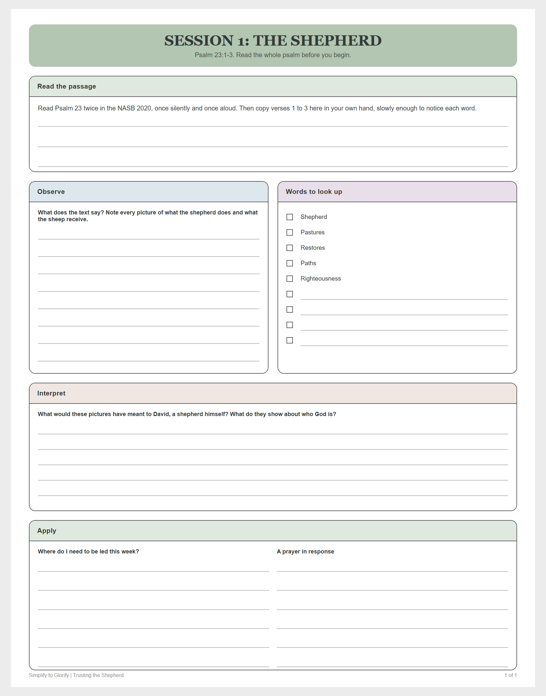

# Topical Study Studio

[](https://github.com/smiln32/topical-study-studio/actions/workflows/validate.yml) [](https://github.com/smiln32/topical-study-studio/releases/tag/v1.1.0) [](LICENSE)

Topical Study Studio makes **topical Bible studies**: six or so sessions on one subject, each a few pages that take the reader through a passage and into application, printed as a PDF for individual or small-group use.

You describe the study, in a form or a JSON file. The tool lays out printable US Letter pages at exactly 816 × 1056 pixels, checks the layout and the wording, and a browser prints the result to PDF.



## What it provides

- A fill-in-the-blanks study starter, and a visual Studio for choosing and arranging pages
- Exact 816 × 1056 px US Letter pages
- Editable HTML text, writing lines, checkboxes, tables, and section containers
- A passage block that prints NASB 2020 text with a reference line and verse numbers
- Validation for page bounds, underfilled layouts, overlapping or crowded blocks, content taller than its box, repeated concepts, repeated prompts, and the verse limit
- Content guidance that keeps every session in order: observation, interpretation, application

## Where it is going

What a study still needs, none of it built yet:

- **Scripture terms:** the check stage will report the verses quoted and export will print the notice. `HANDOFF.md` records where the publisher's current page differs from what this repository assumes.
- **More study content types:** a cross-reference table, a memory-verse card, numbered discussion questions, and a prayer page.
- **A session structure that repeats by design**, so the validator's uniqueness rules apply within a session rather than across the whole set.

## Requirements

- Python 3.9 or newer
- A modern web browser for reviewing generated HTML

No third-party Python packages are required.

## The study starter

The quickest way to make a study. Start the server:

```bash
python study_studio.py
```

Then open `http://127.0.0.1:8765/study-starter.html`, also linked from the Studio's brief page. Fill in the study title, the brand for the footer, and one session per passage: the reference, a title, words to look up, and the observe, interpret, apply and prayer prompts, which the starter fills with wording that names the passage when you leave them blank. Up to four discussion questions give a session a second page. The starter lays out one page per session, checks it, previews every page at true size, and downloads the finished HTML or the specification as JSON. The JSON download needs no server; checking, preview and the finished HTML do.

Without passage text, a page tells the reader where to read and quotes nothing. Paste NASB 2020 text into a session and the page prints it with verse numbers; the block grows to fit and the rows below give up the height, and a passage too long for that gets pages of its own before the session page. Quoted text needs the publisher's notice, which you copy from lockman.org into the form.

## The Studio

The Studio is the visual way to build a study page by page, without editing JSON coordinates. It runs at `http://127.0.0.1:8765`, takes you from a brief to a recommended page blueprint, then lets you edit, reorder, validate, and export in your browser. Drafts are saved in that browser on your computer. Nothing is uploaded to a service or account. Use **Download editable project** to keep a portable JSON backup and **Download finished HTML** for the print-ready pages.

Studio features include study page patterns, page sequencing, a full-page preview, adjustable side panels, snap-to-grid movement by pointer or keyboard, undo and redo, local draft saving, production notes, validation, and HTML/JSON export.

## From the command line

Create a starter specification for a topic, validate it and generate the pages:

```bash
python study_factory.py --init my-study.json --topic "Psalm 23"
python study_factory.py my-study.json output.html --validate-only
python study_factory.py my-study.json output.html
```

Validation messages are written to the terminal. Errors must be corrected before publication; layout warnings should be reviewed rather than ignored.

For a plain-language explanation of the system, setup, commands, validation and printing to PDF, read [`HOW_IT_WORKS.md`](HOW_IT_WORKS.md). The JSON format is documented in [`references/SPECIFICATION.md`](references/SPECIFICATION.md), and [`shared/study_spec_template.json`](shared/study_spec_template.json) and [`shared/examples/study`](shared/examples/study) are places to start.

## Supported content types

- `lines` — open writing space
- `checklist` — predefined and blank checklist items
- `choices` — radio-style or checkbox-style choices
- `callout` — short guidance followed by optional writing lines
- `passage` — quoted NASB 2020 Scripture with a reference line, verse numbers and a place for the notice
- `table` — structured rows such as a cross-reference table
- `split` — two related response areas
- `custom_html` — an advanced escape hatch for layouts not covered by the standard types

Use `custom_html` sparingly. Standard content types are easier to validate and keep visually consistent.

## Design principles

Every page should:

- Focus on one useful concept
- Send the reader to the passage before asking for a response
- Ask specific questions the text can answer
- Match the response format to the effort the question asks
- Provide practical writing space
- Avoid repeating wording or composition from nearby pages
- Move from what the text says toward one realistic response
- Remain legible in print preview and on paper

Visual requirements are in [`references/DESIGN_STANDARD.md`](references/DESIGN_STANDARD.md), and the words in [`references/CONTENT_GUIDE.md`](references/CONTENT_GUIDE.md).

## Using the project with an AI assistant

An assistant that can read this folder starts at [`CLAUDE.md`](CLAUDE.md) and [`CONTEXT.md`](CONTEXT.md). The repository is laid out as an Interpretable Context Methodology (ICM) workspace, and the build is five stages under [`stages/`](stages/), stopping for your approval after each. For a chatbot that cannot read the folder, [`shared/new-chat-starter-prompt.md`](shared/new-chat-starter-prompt.md) contains the same build as one reusable prompt.

AI-generated study content and layouts still require human review. Check every reference, quotation, question and rendered page before publishing or selling a study.

## Sensitive content

This project is not a clinical tool and does not provide diagnosis, treatment, crisis care, or medical advice.

Studies addressing mental health, trauma, disability, medication, grief, addiction, or other sensitive subjects should be reviewed by an appropriately qualified professional before publication. Crisis-related material should direct readers to suitable local emergency or crisis resources and trusted human support.

## Printing to PDF

The generator creates ordinary HTML elements rather than flattened page images. After generation:

1. Review the HTML at full size and in the browser's print preview.
2. Correct clipping, overflow, cramped writing areas, or weak visual hierarchy.
3. Print to PDF at US Letter with no margins and background graphics turned on.
4. Confirm the page count and inspect every page of the PDF.
5. Keep the HTML and JSON beside the PDF so the study can be revised.

Print output differs between browsers, so always check the actual PDF before treating it as finished.

## Repository structure

```text
CLAUDE.md                      Layer 0: where an assistant is and the rules
CONTEXT.md                     Layer 1: where a task goes
stages/                        Layer 2: the build as five folders, each with a contract
  01_brief/ 02_pages/ 03_spec/ 04_check/ 05_export/
_config/                       Layer 3: product.md and design-system.md (Topical Study Studio)
references/                    Layer 3: SPECIFICATION.md, DESIGN_STANDARD.md, CONTENT_GUIDE.md
shared/                        Layer 3: study_spec_template.json, examples/, the chatbot prompt
records/                       The ICM structure audit
study_factory.py               HTML generator and validator
study_studio.py                Local server behind the Studio and the study starter
studio/                        The Studio and the study starter
tests/                         Automated unit tests, including the structure test
assets/                        README preview image and approved design references
HOW_IT_WORKS.md                Plain-language setup and operating guide
DECISIONS.md                   Why things are the way they are
HANDOFF.md                     What comes next
RIGHTS_AND_ATTRIBUTION.md      Ownership of the original assets and third-party notices
LICENSE                        MIT
.github/workflows/             GitHub Actions validation
```

## Contributing

Contributions that improve validation, accessibility, print fidelity, documentation, content types, or layout precision are welcome. Keep changes consistent with the content and design standards and include a representative example when introducing a new content type.

## License

This project is available under the [MIT License](LICENSE). See [Rights and Attribution](RIGHTS_AND_ATTRIBUTION.md) for the scope of original project assets and third-party trademark notices.
